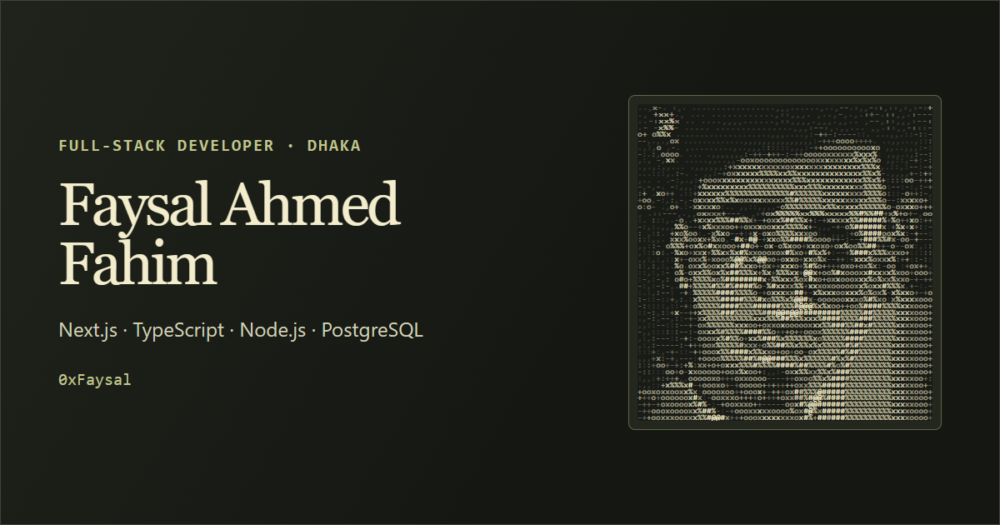

# Faysal Ahmed Fahim · Full-Stack Developer

I'm a full-stack developer in Dhaka and a Computer Science and Engineering student at United International University. This portfolio brings together the web applications I've worked on, my internship experience, and my CV.

[Live portfolio](https://0xfaysal.github.io/) · [Download CV](https://0xfaysal.github.io/resume.pdf) · [LinkedIn](https://www.linkedin.com/in/faysal-ahmed-fahim01)

[](https://0xfaysal.github.io/)

## Selected work

| Project | What I worked on | Links |
| --- | --- | --- |
| **ParkEase BD** | Built map-based parking search and worked on the reservation flow. The platform uses PostgreSQL transactions to coordinate booking holds. | [Demo](https://parkease-bd.vercel.app/) · [Source](https://github.com/0xFaysal/se-lab-wake-up-to-reality) |
| **HelioBay** | Led Team XEN's technical work and integrated live telemetry dashboards and automated charging control. The project won national gold at FIRSO Bangladesh 2026. | [Demo](https://heliobay.vercel.app/) · [Source](https://github.com/0xFaysal/HelioBay) |
| **UNO-Mates** | Built a multiplayer card game for 2–10 players with synchronized rooms, optimistic UI updates, and Playwright tests. | [Demo](https://uno-mates.vercel.app/) · [Source](https://github.com/0xFaysal/UNO-Mates) |
| **Sohojogi** | Worked on a fintech platform that turns informal merchant credit records into portable credit scores. | [Demo](https://sohojogi.vercel.app/) · [Source](https://github.com/0xFaysal/Sohojogi-frontend) |

On desktop, hovering over a project with a live demo reveals a screenshot of its homepage. The screenshots load on demand, and the preview stays stationary when reduced motion is enabled.

## Run locally

The site uses Next.js App Router, React, TypeScript, and Tailwind CSS. Use Node.js 22 to match the deployment workflow.

```sh
npm ci
npm run dev
```

Open [localhost:3000](http://localhost:3000/). To generate the production site, run `npm run build`. The static export is written to `out/`.

## Update the portfolio

| To change | Edit |
| --- | --- |
| Projects, social links, experience, skills, or awards | [src/data/portfolio.ts](src/data/portfolio.ts) |
| Homepage introduction | [src/components/Hero.tsx](src/components/Hero.tsx) |
| Search and share metadata | [src/data/site.ts](src/data/site.ts) and [src/app/layout.tsx](src/app/layout.tsx) |
| Project hover screenshots | [public/project-previews/](public/project-previews/) |
| Downloadable CV | [resume.tex](resume.tex), then rebuild the PDF |

On Windows, place the standalone Tectonic executable at `bin/tectonic.exe`, then run:

```powershell
npm run resume
```

The build checks that the CV is one page and updates both `resume.pdf` and the website's `public/resume.pdf`.

## Deployment

[The GitHub Pages workflow](.github/workflows/deploy.yml) builds and publishes `out/` on pushes to `main`. In **Settings → Pages**, the source is **GitHub Actions**.

The default canonical URL is `https://0xfaysal.github.io/`. If the site moves to a custom domain, configure that domain in Pages and set the repository's Actions variable `SITE_URL` to its HTTPS address. The canonical URL, sitemap, share metadata, and structured data use that setting. The live [sitemap](https://0xfaysal.github.io/sitemap.xml) and [robots.txt](https://0xfaysal.github.io/robots.txt) are generated during the build.
